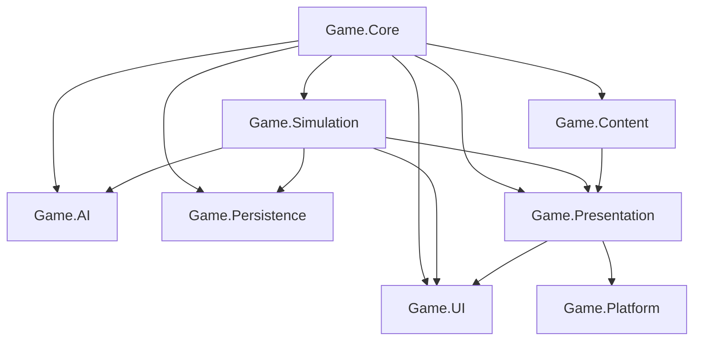

# Архитектура проекта "Robot Strategy"

## 1. Общие принципы
Проект разрабатывается согласно ТЗ v0.1 в изометрическом 3D-формате на Unity 6 (URP) с целевой платформой Android.
Главный принцип — **чистое ядро без зависимостей от `UnityEngine`**:
- Игровая симуляция выполняется на дискретных тиках (20 тактов в секунду).
- Вся логика боя, движения, захвата и экономики детерминирована и изолирована.
- Графический слой Unity (`Presentation`) интерполирует позиции и отображает эффекты/звуки на основе состояния симуляции.
- Команды игрока и ИИ используют единый публичный интерфейс `ICommandDispatcher`.

## 2. Модули и Assembly Definitions

### Модули:
1. **Game.Core** (чистый C#)
   - Идентификаторы (`EntityId`, `PlayerId`, `ModuleId`).
   - Состояния (`MatchState`, `RobotState`, `BuildingState`, `PlayerState`).
   - Модели команд (`ICommand`, `MoveCommand`, `AttackCommand`, `CaptureCommand`, `ProduceOrderCommand`).
   - Контракт диспетчера команд `ICommandDispatcher`.
   - Не имеет зависимостей от `UnityEngine`.

2. **Game.Simulation** (чистый C#)
   - `MatchSimulation`: тактовый цикл с фиксированным шагом (20 тиков/с). Порядок тика: команды replay → агенты (ИИ) → `ProductionSystem` → `OrderPlanner` → `MovementSystem` → `FogOfWarSystem` → `CombatSystem` → `CaptureSystem`. Сцена вызывает `AdvanceFrame(Time.deltaTime)`, `HeadlessMatchRunner` — тот же `Step`, поэтому журнал команд воспроизводит матч независимо от FPS.
   - `ProductionSystem`: почасовой доход ресурсов по типам (`GameClock`, `EconomyRules`, `ResourceStock`), очереди производства, блокировка выходов.
   - `NavigationGrid` / `AStarPathfinder` / `BuildingFootprint`: дискретная сетка проходимости с корпусами зданий, расчёт путей.
   - `OrderPlanner`: превращает приказы (захват, оборона, разведка, движение, атака, охота) в маршруты и боевой манёвр.
   - `MovementSystem`: следование по пути и ручной привод, локальный объезд роботов и зданий, скорость и курс.
   - `CombatSystem`: проверка дистанции, перезарядки, прямого урона и сплеша, снаряды с временем полёта.
   - `CaptureSystem`: таймеры захвата заводов и баз, споры за точку.
   - `FogOfWarSystem`: отдельные клетки обзора сторон (неизвестно / разведано / видно), обзор роботов и зданий, скалы перекрывают луч зрения. Уже видимые клетки не проверяются повторно; таблица числа скал позволяет пропускать трассировку луча в областях без препятствий. Карта считается неизменной в течение матча. Неизвестные цели недоступны для приказов и ИИ; программа разведывает карту, если ни одно правило не сработало. Последние замеченные позиции врагов хранятся отдельно от текущей видимости и удаляются при проверке прежней клетки. Разведка, отметки и пороги HP входят в состояние и сохранение; команды — в replay.
   - Планируется: `SpatialHashGrid` для быстрого поиска ближайших целей.
   - Состояние движения (путь, ручной привод, расписание манёвра) и счётчики ID хранятся в `MatchState`, поэтому входят в сохранения. Presentation только интерполирует позиции между тиками.

3. **Game.Content** (C# / ScriptableObjects для редактора)
   - Определения деталей (`ModuleDefinition`, типы слотов, socket-крепления).
   - Определения карт (`MapDefinition`, проходимость тайлов, точки баз и заводов).
   - Валидатор сборки робота (`RobotAssemblyValidator`).

4. **Game.AI** (чистый C#)
   - Логика бота: оценка опасности базы, выбор рецептов сборки, захват точек, атака.
   - Отдает команды исключительно через `ICommandDispatcher`.

5. **Game.Persistence**
   - Сохранение и загрузка состояния (`MatchSnapshot`, 3 ручных слота + автосейв).
   - Replay-лог команд для быстрого воспроизведения матча.

6. **Game.Presentation** (Unity 3D / URP)
   - Визуальные префабы, скелеты роботов и привязка мешей к сокетам.
   - Камера (изометрия, перемещение пальцем, зум).
   - VFX (снаряды пушек, ракеты, взрывы, индикаторы захвата) и SFX.
   - Туман отображается текстурой поверх карты и миникарты. Три локальных шаблона программы хранятся в `PlayerPrefs`: приоритеты, радиусы и пороги HP (включая аварийное отступление); ID целей не сохраняются между матчами. Отступление ведёт к своему зданию, но не лечит робота.

7. **Game.UI**
   - Экраны: Главное меню, Выбор карты, Бой (панель ресурсов, миникарта, кнопки приказов), Конструктор роботов, База, Пауза, Экран результатов.
